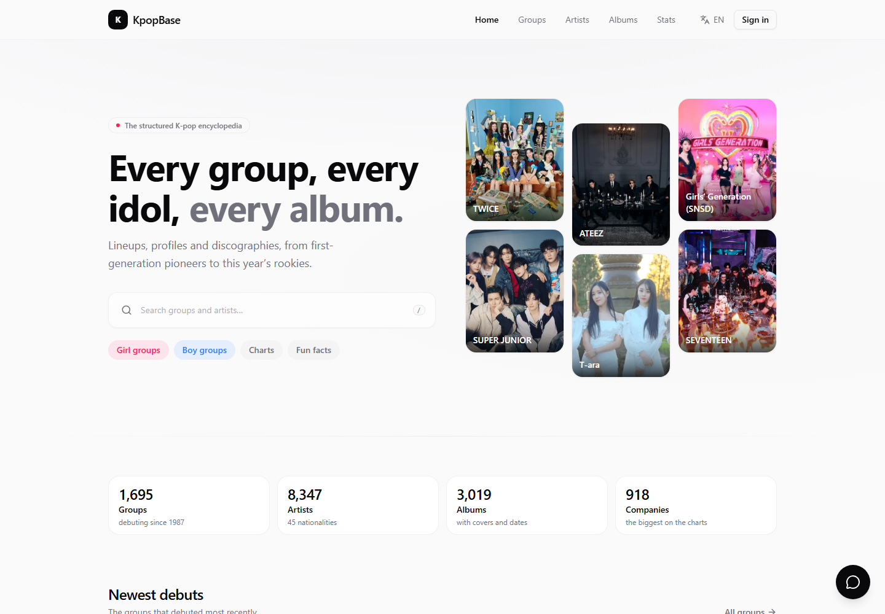
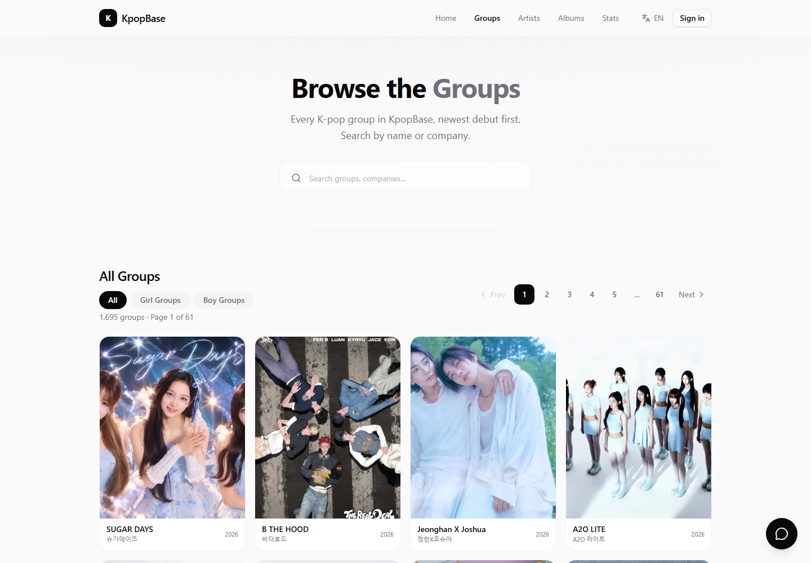
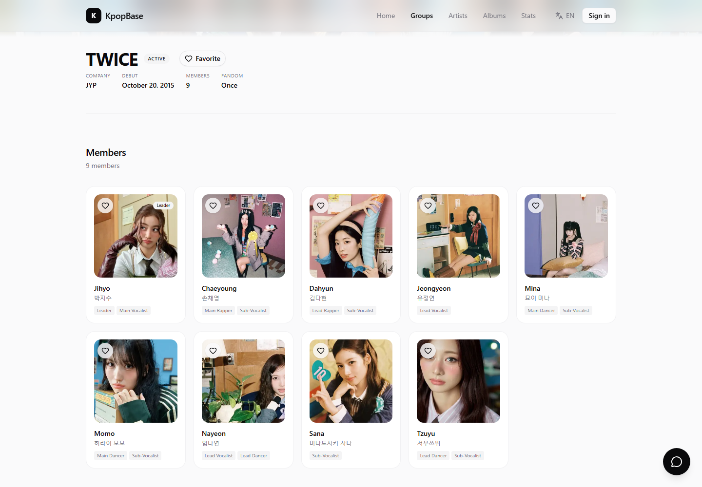
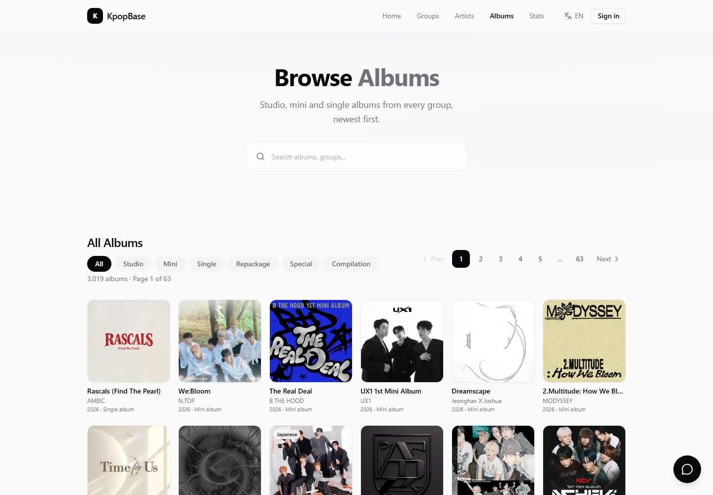
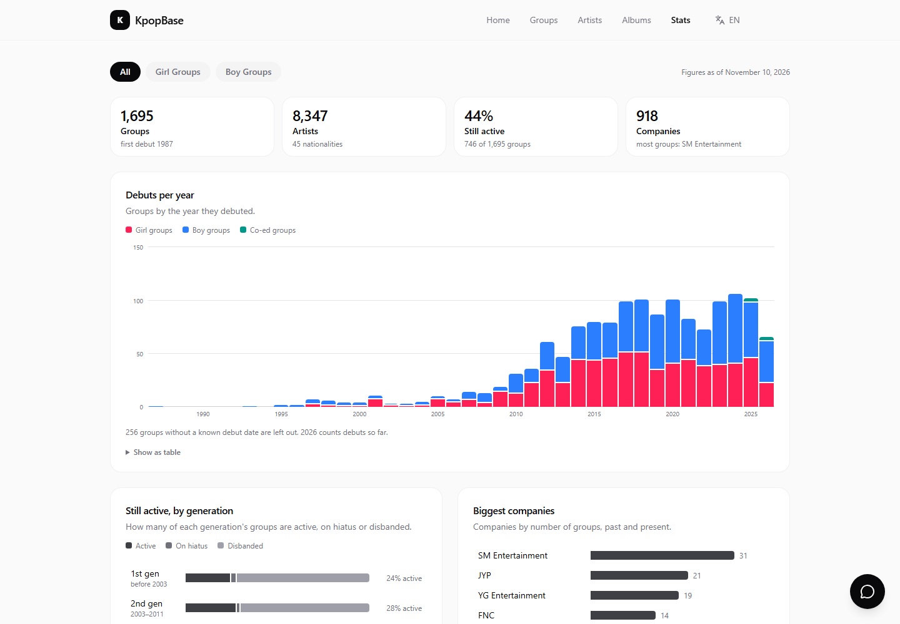
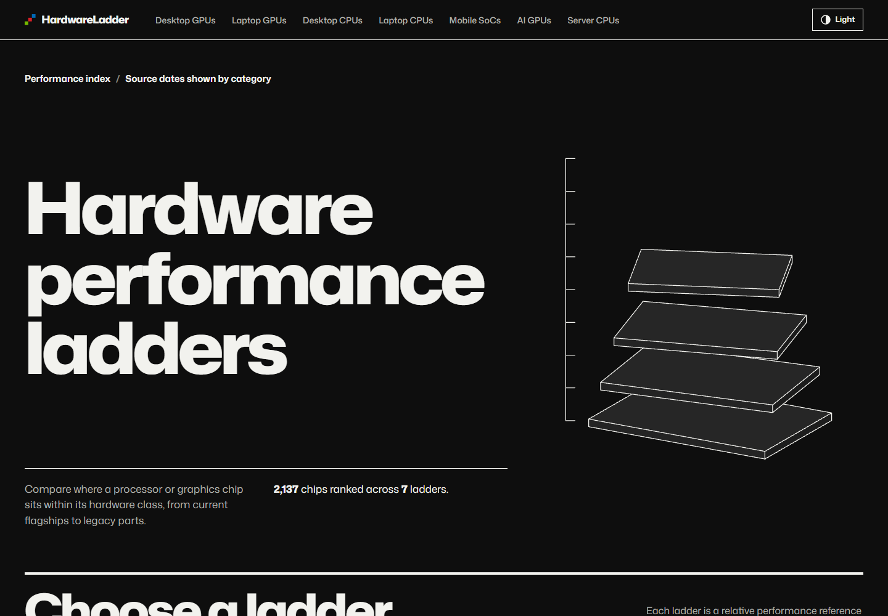
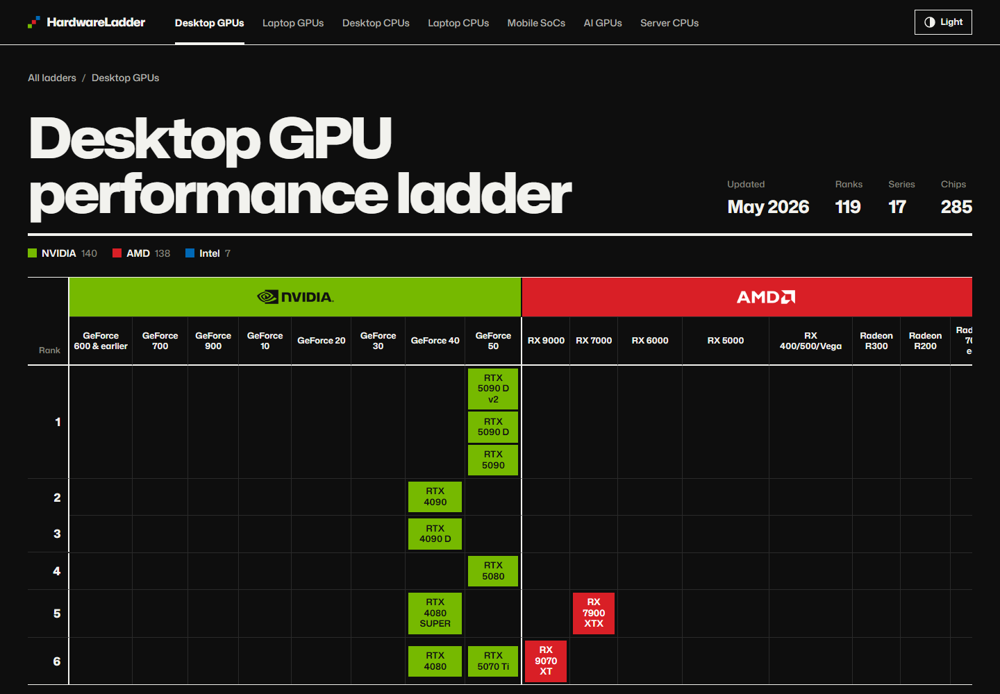
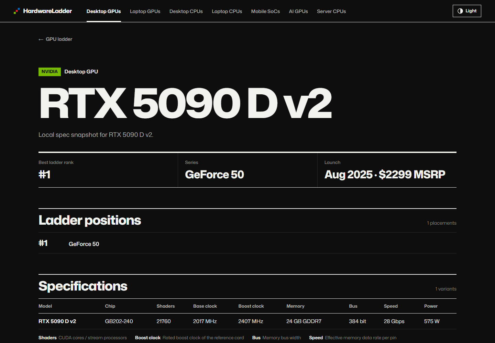
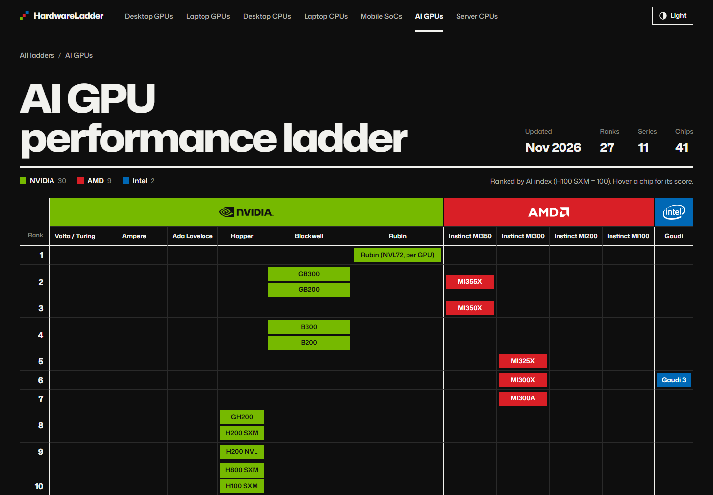
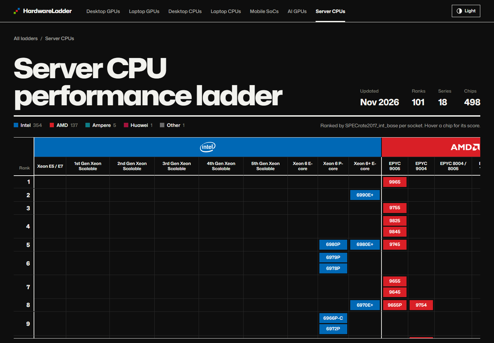

# Hi there, I'm Jinyao! 👋  

## 🚀 About Me  
- 🔥 **Software 3.0 Explorer** | Building Agentic AI Infrastructure & Tooling Ecosystem (MCP)
- 💻 Full-stack developer crafting high-performance industrial software
- 🎨 Deep diving into Compilers, CUDA & Linux Kernel Optimization
- 🎓 MSc Computer Science @ TU Darmstadt
- 🏋️ Breaking dancer | 🎸 Guitar & art on the side
- 🌍 Chinese | English | German | 日本語 (B2) | 한국어 (A1) | Русский (A1)

📬 **Get in touch:** - ✉️ [cjy513203427@gmail.com](mailto:cjy513203427@gmail.com)  

---

## 🌐 Live Projects

<table>
  <tr>
    <td width="50%" valign="top">
      <h3><a href="https://k-pop-base.com/">KpopBase</a></h3>
      
      
A structured K-pop encyclopedia with group profiles, artist lineups, discographies, charts, and personal memory albums.

      
<a href="https://k-pop-base.com/"><strong>Explore KpopBase →</strong></a>

      

        
<strong>Explore the features</strong> · 4 previews

        
Discover groups, explore member profiles, browse releases, and follow the numbers behind K-pop.

        <table width="100%">
          <tr>
            <td width="50%" valign="top">
              
              
<strong><a href="https://k-pop-base.com/groups">Group Discovery</a></strong> Search by group or company, filter by group type, and browse photo cards.

            </td>
            <td width="50%" valign="top">
              
              
<strong><a href="https://k-pop-base.com/group/twice">Group Profiles &amp; Members</a></strong> Explore debut details, fandoms, member lineups, and individual artist profiles.

            </td>
          </tr>
          <tr>
            <td width="50%" valign="top">
              
              
<strong><a href="https://k-pop-base.com/albums">Album Library</a></strong> Browse cover art and release details, search artists or albums, and filter by album type.

            </td>
            <td width="50%" valign="top">
              
              
<strong><a href="https://k-pop-base.com/charts">Charts &amp; Statistics</a></strong> Explore debut trends, group generations, companies, and artist demographics.

            </td>
          </tr>
        </table>
      

    </td>
    <td width="50%" valign="top">
      <h3><a href="https://chipranks.com/">ChipRanks · HardwareLadder</a></h3>
      
      
Hardware performance ladders for desktop and laptop CPUs and GPUs, mobile chips, AI accelerators, and server processors.

      
<a href="https://chipranks.com/"><strong>Explore ChipRanks →</strong></a>

      

        
<strong>Explore the features</strong> · 4 previews

        
Explore visual performance ladders, inspect individual chip specifications, and browse consumer and data center hardware.

        <table width="100%">
          <tr>
            <td width="50%" valign="top">
              
              
<strong><a href="https://chipranks.com/gpu/">Desktop GPU Ladder</a></strong> Compare GPU generations and vendors in a visual performance ranking.

            </td>
            <td width="50%" valign="top">
              
              
<strong><a href="https://chipranks.com/gpu/nvidia-rtx5090d-v2/">Chip Specifications</a></strong> Inspect ladder positions, launch information, memory, clock speeds, and power.

            </td>
          </tr>
          <tr>
            <td width="50%" valign="top">
              
              
<strong><a href="https://chipranks.com/ai-gpu/">AI Accelerator Rankings</a></strong> Explore NVIDIA, AMD Instinct, and Intel Gaudi accelerators on a dedicated AI ladder.

            </td>
            <td width="50%" valign="top">
              
              
<strong><a href="https://chipranks.com/server-cpu/">Server CPU Rankings</a></strong> Browse Xeon, EPYC, and Arm server CPUs ranked by published SPECrate results.

            </td>
          </tr>
        </table>
      

    </td>
  </tr>
</table>

---

## 📦 Open Source Projects

### 🤖 [intersystems-objectscript-routine-mcp](https://www.npmjs.com/package/intersystems-objectscript-routine-mcp)
> **Software 3.0 Ecosystem:** An open-source Model Context Protocol (MCP) server that bridges LLMs (like Claude/Cursor) with InterSystems IRIS, empowering AI agents to seamlessly inspect, read, and manage server routines.
> 
> 📦 **[Available on npm](https://www.npmjs.com/package/intersystems-objectscript-routine-mcp)** | 💻 **[GitHub Repository](https://github.com/cjy513203427/intersystems-objectscript-routine-mcp)**

### 🔌 [InterSystems ObjectScript Class Diagram View](https://marketplace.visualstudio.com/items?itemName=JinyaoChen.intersystems-objectscript-class-diagram-view)
> **Developer Tooling:** A VS Code extension designed to visualize InterSystems ObjectScript class structures into interactive diagrams, drastically improving architectural comprehension.
> 
> 🔗 **[View on VS Code Marketplace](https://marketplace.visualstudio.com/items?itemName=JinyaoChen.intersystems-objectscript-class-diagram-view)**

---

## 📚 Open Source Contributions

- **Contributor to [Anomalib](https://github.com/open-edge-platform/anomalib)** — A library for training and benchmarking anomaly detection algorithms. [My contributions →](https://github.com/open-edge-platform/anomalib/pulls?q=is%3Apr+author%3Acjy513203427)
- **Contributor to [VSCode ObjectScript](https://github.com/intersystems-community/vscode-objectscript)** — InterSystems ObjectScript extension for Visual Studio Code.

---

## 🏆 GitHub Trophies  

  

  

---

## 🧑‍💻 Recent Activity  

  

  

---

## 🚀 Keep Pushing Forward!  
✨ **Always stay passionate, keep learning, and never give up!** ✨
